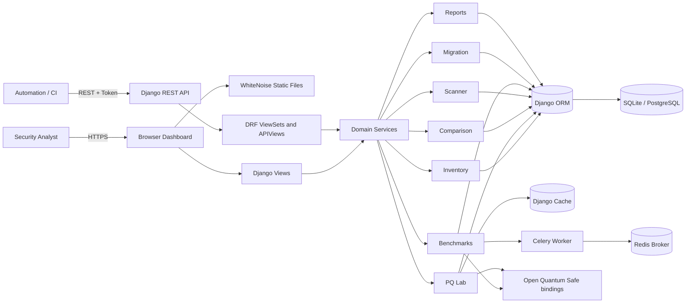
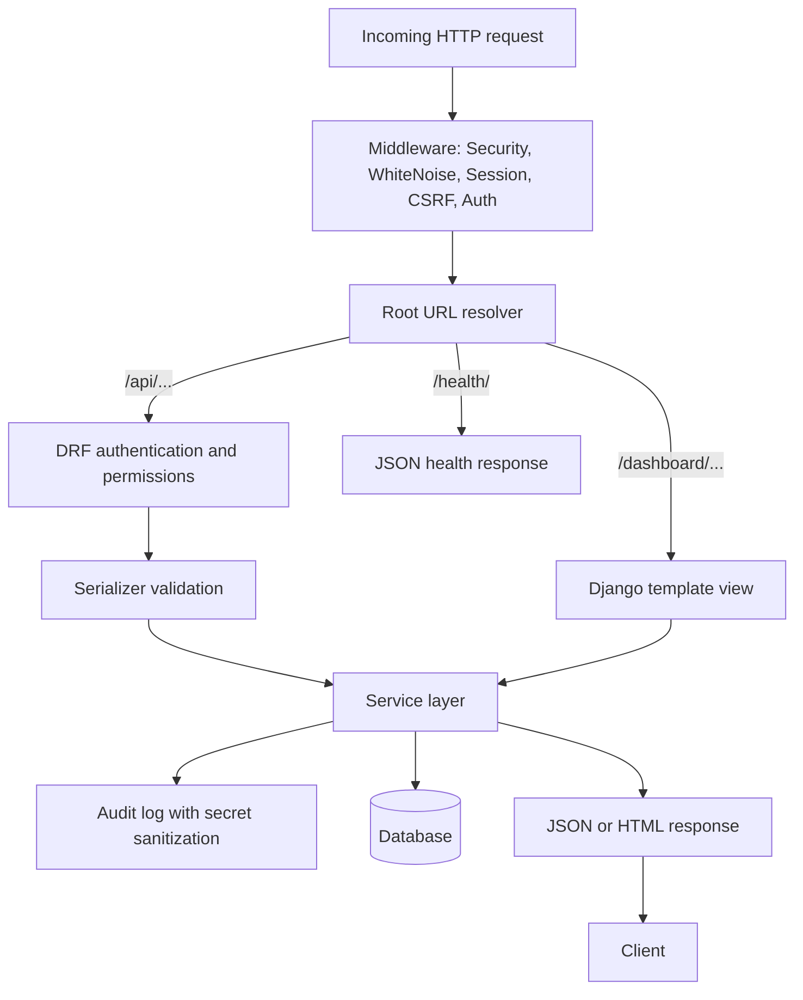
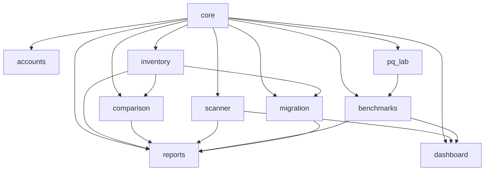
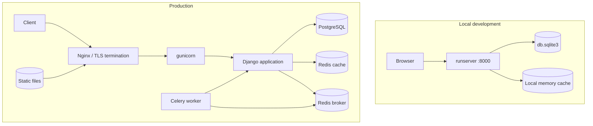
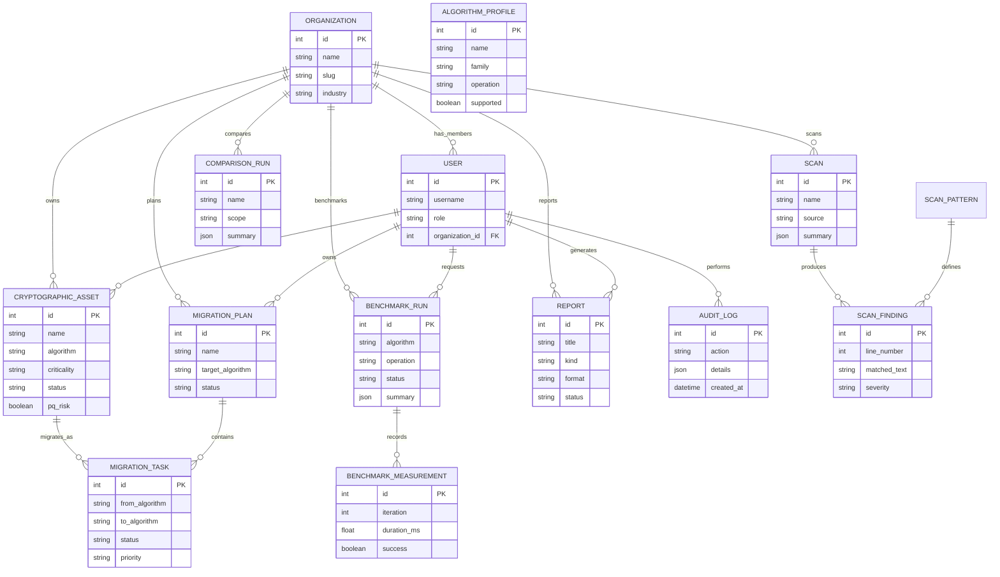
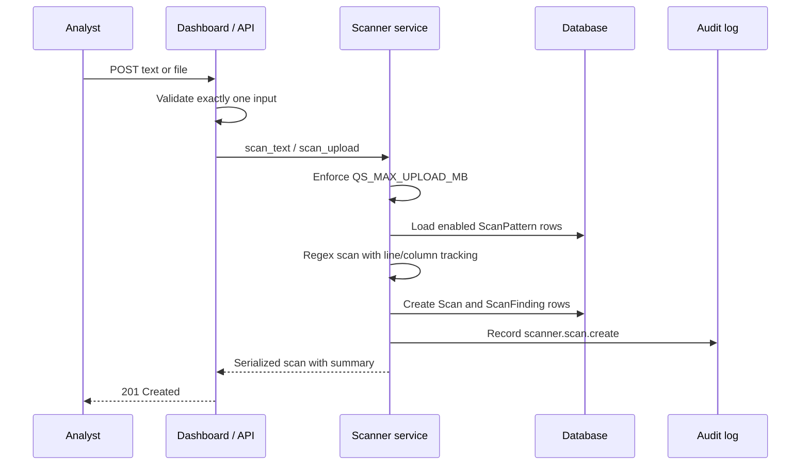
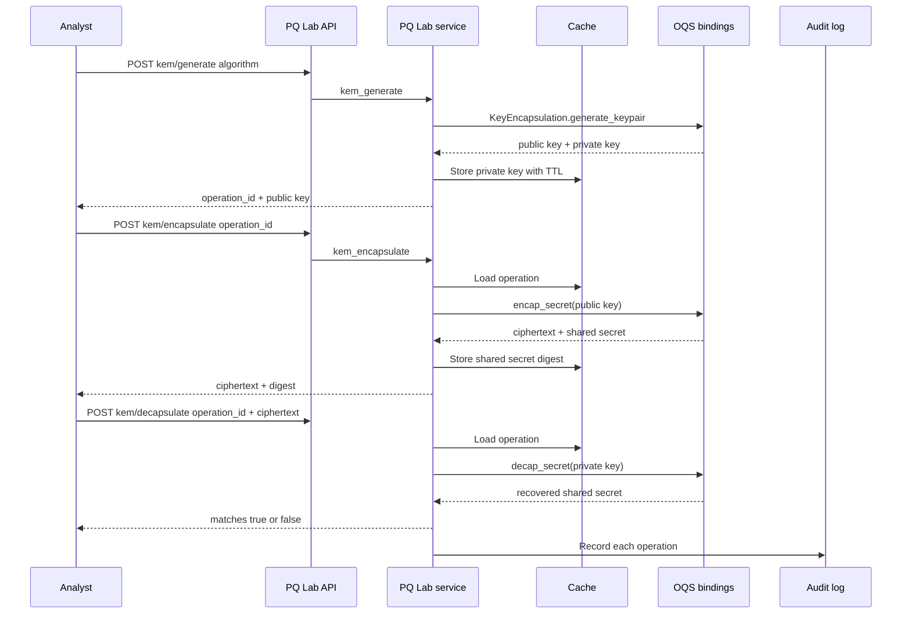
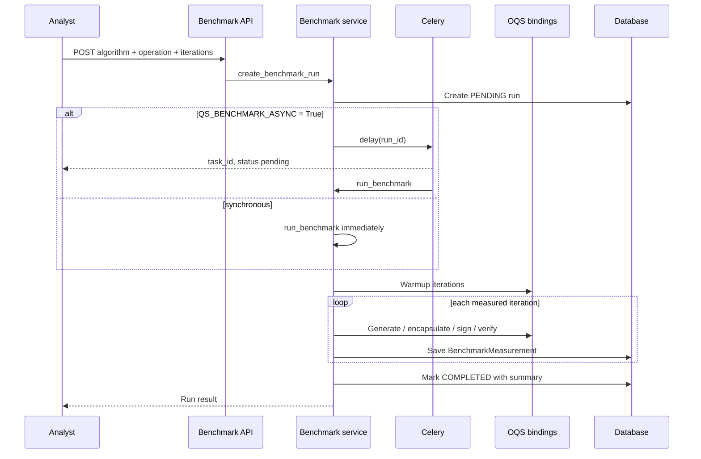
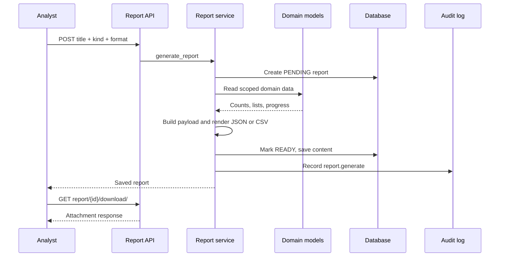

# QuantumShield

**Post-quantum cryptographic readiness, inventory, assessment, and migration platform.**

> **Author:** N J Bala Manikantan  
> **Repository:** https://github.com/Njbalamani/QUANTUM-SHIELD  
> **License:** MIT  
> **Stack:** Python 3.12 · Django 6.1 · Django REST Framework 3.18 · Celery · Redis · PostgreSQL/SQLite · Open Quantum Safe (OQS)

QuantumShield gives security teams one place to **catalog cryptographic assets**, **detect quantum-vulnerable algorithms**, **experiment with post-quantum primitives**, **benchmark algorithms**, **plan migrations**, and **generate board-ready reports**.

This repository keeps the deployable Django project inside the `QUANTUM-SHIELD/` folder.

---

## Table of contents

1. [What is QuantumShield](#1-what-is-quantumshield)
2. [Feature map](#2-feature-map)
3. [Architecture](#3-architecture)
4. [Repository structure](#4-repository-structure)
5. [Data model](#5-data-model)
6. [Technology stack](#6-technology-stack)
7. [Prerequisites](#7-prerequisites)
8. [Quick start — ordered commands](#8-quick-start--ordered-commands)
9. [Environment variables](#9-environment-variables)
10. [First-use workflow](#10-first-use-workflow)
11. [API reference](#11-api-reference)
12. [End-to-end workflows](#12-end-to-end-workflows)
13. [Testing](#13-testing)
14. [Production deployment](#14-production-deployment)
15. [Troubleshooting](#15-troubleshooting)
16. [Security notes](#16-security-notes)
17. [Roadmap](#17-roadmap)
18. [License](#18-license)

---

## 1. What is QuantumShield

Quantum computers will break widely deployed public-key algorithms such as **RSA**, **ECDSA**, **ECDH**, and **DSA**. Most organizations do not know where those algorithms live, which systems are most exposed, or what to replace them with.

QuantumShield answers four questions:

| Question | QuantumShield capability |
|---|---|
| Where are our cryptographic assets? | Inventory of organizations, assets, algorithms, protocols, owners, and criticality |
| Which assets are quantum-vulnerable? | Automatic `pq_risk` classification and source/config scanning |
| What post-quantum algorithms should we use? | PQ lab, algorithm profiles, side-by-side comparison, and measured benchmarks |
| How do we migrate safely? | Migration plans, generated tasks, status tracking, and reports |

The platform combines a **server-rendered dashboard** for humans with a **complete REST API** for automation.

---

## 2. Feature map

| Area | App | Main capability | Endpoint prefix |
|---|---|---|---|
| Accounts and RBAC | `accounts` | Token auth, users, roles: admin / analyst / viewer | `/api/accounts/` |
| Core domain | `core` | Organizations, assets, algorithm profiles, audit logs, crypto helpers | shared |
| Inventory | `inventory` | CRUD for inventory and audit history | `/api/inventory/` |
| Post-quantum lab | `pq_lab` | KEM and signature experiments with ephemeral private keys | `/api/pq/` |
| Comparison | `comparison` | Inventory readiness and algorithm shortlist comparisons | `/api/comparison/` |
| Scanner | `scanner` | Regex-based scans of text or uploaded files | `/api/scanner/` |
| Benchmarks | `benchmarks` | Timed KEM/signature runs with per-iteration measurements | `/api/benchmarks/` |
| Migration | `migration` | Plans, generated tasks, progress, and status changes | `/api/migration/` |
| Reports | `reports` | JSON/CSV snapshots of any domain area | `/api/reports/` |
| Dashboard | `dashboard` | Landing page, login, dashboard, health endpoint | `/` |

Role model:

| Role | Can read | Can write | Can delete / admin actions |
|---|---|---|---|
| Viewer | Yes | No | No |
| Analyst | Yes | Yes | No |
| Admin | Yes | Yes | Yes |

---

## 3. Architecture

### 3.1 High-level architecture



### 3.2 Request lifecycle



### 3.3 Module dependency map



### 3.4 Deployment topology



---

## 4. Repository structure

```text
QUANTUM-SHIELD/                         # repository root
├─ .gitignore                           # ignore rules for secrets and artifacts
├─ LICENSE                              # MIT license, N J Bala Manikantan
├─ README.md                            # this repository guide
└─ QUANTUM-SHIELD/                      # Django project root
   ├─ .env.example                      # environment variable template
   ├─ .gitignore                        # ignore rules for secrets and artifacts
   ├─ LICENSE                           # MIT license copy
   ├─ README.md                         # project-level guide
   ├─ .gitignore                        # ignore rules for secrets and artifacts
   ├─ manage.py                         # Django management entry point
   ├─ requirements.txt                  # pinned Python dependencies
   ├─ accounts/                         # custom user, roles, token API
   │  ├─ migrations/
   │  ├─ admin.py
   │  ├─ models.py
   │  ├─ serializers.py
   │  ├─ tests.py
   │  ├─ urls.py
   │  └─ views.py
   ├─ benchmarks/                       # PQ benchmarking engine
   │  ├─ migrations/
   │  ├─ admin.py
   │  ├─ models.py
   │  ├─ serializers.py
   │  ├─ services.py
   │  ├─ tasks.py
   │  ├─ tests.py
   │  ├─ urls.py
   │  └─ views.py
   ├─ comparison/                       # inventory and algorithm comparison
   │  ├─ migrations/
   │  ├─ admin.py
   │  ├─ models.py
   │  ├─ serializers.py
   │  ├─ services.py
   │  ├─ tests.py
   │  ├─ urls.py
   │  └─ views.py
   ├─ core/                             # shared domain and utilities
   │  ├─ migrations/
   │  ├─ admin.py
   │  ├─ audit.py                       # audit writer and secret redaction
   │  ├─ crypto.py                      # OQS capability layer and base64 helpers
   │  ├─ models.py                      # Organization, Asset, Profile, AuditLog
   │  ├─ permissions.py                 # role-based DRF permissions
   │  └─ tests.py
   ├─ dashboard/                        # web UI and health endpoint
   │  ├─ context_processors.py
   │  ├─ forms.py
   │  ├─ services.py
   │  ├─ tests.py
   │  ├─ urls.py
   │  └─ views.py
   ├─ inventory/                        # inventory REST API
   │  ├─ migrations/
   │  ├─ serializers.py
   │  ├─ tests.py
   │  ├─ urls.py
   │  └─ views.py
   ├─ migration/                        # migration plans and tasks
   │  ├─ migrations/
   │  ├─ admin.py
   │  ├─ models.py
   │  ├─ serializers.py
   │  ├─ services.py
   │  ├─ tests.py
   │  ├─ urls.py
   │  └─ views.py
   ├─ pq_lab/                           # KEM and signature operations
   │  ├─ serializers.py
   │  ├─ services.py
   │  ├─ tests.py
   │  ├─ urls.py
   │  └─ views.py
   ├─ quantumshield/                    # project configuration
   │  ├─ asgi.py
   │  ├─ celery.py
   │  ├─ settings.py
   │  ├─ urls.py
   │  └─ wsgi.py
   ├─ reports/                          # report generation and downloads
   │  ├─ migrations/
   │  ├─ admin.py
   │  ├─ models.py
   │  ├─ serializers.py
   │  ├─ services.py
   │  ├─ tests.py
   │  ├─ urls.py
   │  └─ views.py
   ├─ scanner/                          # scanning rules and findings
   │  ├─ migrations/
   │  ├─ admin.py
   │  ├─ models.py
   │  ├─ serializers.py
   │  ├─ services.py
   │  ├─ tests.py
   │  ├─ urls.py
   │  └─ views.py
   ├─ static/                           # css/ and js/ source assets
   ├─ templates/                        # base, home, login, dashboard pages
   └─ media/                            # uploaded media storage
```

---

## 5. Data model



Key design notes:

- `CryptographicAsset.pq_risk` is a computed property, not a stored column, so classification rules evolve without data migrations.
- Ephemeral private keys from the PQ lab are stored in the Django cache with a TTL and are never written to the database.
- Every mutating API call writes an `AuditLog`; secret-like fields are redacted by `core.audit.sanitize`.

---

## 6. Technology stack

| Layer | Technology | Purpose |
|---|---|---|
| Language | Python 3.12 | Application runtime |
| Web framework | Django 6.1 | ORM, auth, admin, templates, middleware |
| API | Django REST Framework 3.18 | ViewSets, serializers, token auth, pagination |
| Filtering | django-filter | Optional queryset filtering with manual fallback |
| Database | SQLite or PostgreSQL | Development uses SQLite; production uses PostgreSQL |
| Static files | WhiteNoise | Serve compiled static assets without a separate file server |
| Async jobs | Celery 5.7 | Optional asynchronous benchmark execution |
| Broker/cache | Redis 8 | Celery broker and ephemeral key cache in production |
| PQ primitives | liboqs-python | KEM and signature operations |
| Crypto helpers | cryptography 50 | Library version reporting and local crypto support |
| Server | gunicorn 23 | Production WSGI server |
| Config | python-dotenv | `.env` loading |
| Tests | Django TestCase / DRF APITestCase | 77 automated tests |

---

## 7. Prerequisites

Before starting, install:

| Requirement | Version | Notes |
|---|---|---|
| Python | 3.12+ | `python --version` |
| pip | 24+ | `python -m pip --version` |
| Git | any recent | `git --version` |
| Redis | 7+ | Only needed for Celery / shared cache |
| PostgreSQL | 14+ | Only needed for production database |
| liboqs-python | 0.16+ | Installed through `requirements.txt`; PQ operations degrade gracefully if unavailable |

Check your versions:

```powershell
python --version
python -m pip --version
git --version
```

---

## 8. Quick start — ordered commands

Run these commands **in order** from the repository root.

### 8.1 Windows PowerShell

```powershell
# 1. Enter the repository
cd .\QUANTUM-SHIELD

# 2. Create and activate a virtual environment
python -m venv .venv
.\.venv\Scripts\Activate.ps1

# 3. Upgrade packaging tools
python -m pip install --upgrade pip setuptools wheel

# 4. Install dependencies
python -m pip install -r requirements.txt

# 5. Create your local environment file
Copy-Item .env.example .env

# 6. Verify configuration
python manage.py check

# 7. Apply database migrations
python manage.py migrate

# 8. Create an administrator
python manage.py createsuperuser

# 9. Seed scanner patterns
python manage.py shell -c "from scanner.services import ensure_default_patterns; print(ensure_default_patterns())"

# 10. Collect static files
python manage.py collectstatic --noinput

# 11. Run the test suite
python manage.py test

# 12. Start the development server
python manage.py runserver
```

### 8.2 macOS / Linux

```bash
# 1. Enter the repository
cd QUANTUM-SHIELD

# 2. Create and activate a virtual environment
python3 -m venv .venv
source .venv/bin/activate

# 3. Upgrade packaging tools
python -m pip install --upgrade pip setuptools wheel

# 4. Install dependencies
python -m pip install -r requirements.txt

# 5. Create your local environment file
cp .env.example .env

# 6. Verify configuration
python manage.py check

# 7. Apply database migrations
python manage.py migrate

# 8. Create an administrator
python manage.py createsuperuser

# 9. Seed scanner patterns
python manage.py shell -c "from scanner.services import ensure_default_patterns; print(ensure_default_patterns())"

# 10. Collect static files
python manage.py collectstatic --noinput

# 11. Run the test suite
python manage.py test

# 12. Start the development server
python manage.py runserver
```

### 8.3 Verify the installation

Open these URLs after `runserver` starts:

| URL | Expected result |
|---|---|
| `http://127.0.0.1:8000/` | Public landing page |
| `http://127.0.0.1:8000/login/` | Login form |
| `http://127.0.0.1:8000/dashboard/` | Dashboard after login |
| `http://127.0.0.1:8000/health/` | JSON health response |
| `http://127.0.0.1:8000/admin/` | Django admin |
| `http://127.0.0.1:8000/api/pq/capabilities/` | OQS capability report after login |

---

## 9. Environment variables

Copy `.env.example` to `.env` and adjust as needed. The application loads `.env` automatically through `python-dotenv`.

### Core settings

| Variable | Default | Purpose |
|---|---|---|
| `DJANGO_SECRET_KEY` | insecure local key | Django signing key. **Always set in production.** |
| `DJANGO_DEBUG` | `True` | Enables debug mode. Set to `False` in production. |
| `DJANGO_ALLOWED_HOSTS` | `localhost,127.0.0.1` | Comma-separated hostnames. |
| `DJANGO_CSRF_TRUSTED_ORIGINS` | `http://localhost,http://127.0.0.1` | Comma-separated trusted origins. |

### Database settings

| Variable | Default | Purpose |
|---|---|---|
| `DB_ENGINE` | `django.db.backends.sqlite3` | Django database backend. |
| `DB_NAME` | `db.sqlite3` | SQLite path or PostgreSQL database name. |
| `DB_USER` | `quantumshield` | PostgreSQL user. |
| `DB_PASSWORD` | empty | PostgreSQL password. |
| `DB_HOST` | `localhost` | PostgreSQL host. |
| `DB_PORT` | `5432` | PostgreSQL port. |
| `DB_CONN_MAX_AGE` | `60` | Persistent connection lifetime. |
| `DB_SSLMODE` | `prefer` | PostgreSQL SSL mode. |

### Celery settings

| Variable | Default | Purpose |
|---|---|---|
| `CELERY_BROKER_URL` | `redis://localhost:6379/0` | Celery broker. |
| `CELERY_RESULT_BACKEND` | `redis://localhost:6379/1` | Celery result store. |
| `CELERY_TASK_ALWAYS_EAGER` | `False` | Run tasks synchronously when `True`. Useful for tests. |

### QuantumShield settings

| Variable | Default | Purpose |
|---|---|---|
| `QS_OQS_PREFIX` | empty | Optional Open Quantum Safe install prefix, mainly for Windows DLL loading. |
| `QS_EPHEMERAL_KEY_TTL` | `300` | Seconds before a PQ lab private key expires from cache. |
| `QS_MAX_UPLOAD_MB` | `2` | Maximum text/file scan size in megabytes. |
| `QS_BENCHMARK_ITERATIONS` | `10` | Default measured iterations. |
| `QS_BENCHMARK_WARMUP_ITERATIONS` | `2` | Warmup iterations before measurement. |
| `QS_BENCHMARK_MAX_ITERATIONS` | `200` | Hard ceiling for requested iterations. |
| `QS_BENCHMARK_ASYNC` | `False` | Dispatch benchmarks through Celery when `True`. |
| `DJANGO_LOG_LEVEL` | `INFO` | Root logging level. |

### Production security settings

Applied automatically when `DJANGO_DEBUG=False`:

| Setting | Default in production |
|---|---|
| `SECURE_PROXY_SSL_HEADER` | `HTTP_X_FORWARDED_PROTO = https` |
| `SECURE_SSL_REDIRECT` | `True` |
| `SESSION_COOKIE_SECURE` | `True` |
| `CSRF_COOKIE_SECURE` | `True` |
| `SECURE_HSTS_SECONDS` | `31536000` |
| `SECURE_HSTS_INCLUDE_SUBDOMAINS` | `True` |
| `SECURE_HSTS_PRELOAD` | `True` |
| `X_FRAME_OPTIONS` | `DENY` |

---

## 10. First-use workflow

These commands assume Windows PowerShell and a superuser token. Replace credentials with your own.

```powershell
# 1. Obtain an API token
$response = Invoke-RestMethod -Uri "http://127.0.0.1:8000/api/accounts/token/" `
  -Method Post `
  -ContentType "application/json" `
  -Body '{"username":"admin","password":"your-password"}'
$token = $response.token

# 2. Build a reusable authorization header
$headers = @{ Authorization = "Token $token" }

# 3. Create an organization
$org = Invoke-RestMethod -Uri "http://127.0.0.1:8000/api/inventory/organizations/" `
  -Method Post -Headers $headers -ContentType "application/json" `
  -Body '{"name":"Acme Corporation","slug":"acme","industry":"Financial services"}'

# 4. Seed scanner rules (skip if already seeded)
Invoke-RestMethod -Uri "http://127.0.0.1:8000/api/scanner/patterns/seed/" `
  -Method Post -Headers $headers | Out-Null

# 5. Create a cryptographic asset
Invoke-RestMethod -Uri "http://127.0.0.1:8000/api/inventory/assets/" `
  -Method Post -Headers $headers -ContentType "application/json" `
  -Body '{"organization":1,"name":"Payments API","algorithm":"RSA-2048","key_size":2048,"criticality":"critical","status":"active"}' |
  Select-Object id, name, algorithm, pq_risk

# 6. Run a source/config scan
Invoke-RestMethod -Uri "http://127.0.0.1:8000/api/scanner/scans/" `
  -Method Post -Headers $headers -ContentType "application/json" `
  -Body '{"name":"Payments config scan","organization":1,"text":"tls: TLS1.0\nsigning: RSA-2048\nhash: SHA1"}' |
  Select-Object id, name, summary

# 7. Read available PQ capabilities and pick the first enabled KEM
$caps = Invoke-RestMethod -Uri "http://127.0.0.1:8000/api/pq/capabilities/" -Headers $headers
$kem = $caps.enabled_kems | Select-Object -First 1
$kem

# 8. Run a benchmark with that algorithm
Invoke-RestMethod -Uri "http://127.0.0.1:8000/api/benchmarks/runs/" `
  -Method Post -Headers $headers -ContentType "application/json" `
  -Body (@{ algorithm = $kem; operation = "kem"; iterations = 5; organization = 1 } | ConvertTo-Json) |
  Select-Object id, algorithm, status, summary

# 9. Preview an algorithm comparison
Invoke-RestMethod -Uri "http://127.0.0.1:8000/api/comparison/runs/preview/" `
  -Method Post -Headers $headers -ContentType "application/json" `
  -Body '{"name":"PQ shortlist","scope":"algorithms","algorithms":["ML-KEM-512","ML-DSA-44"]}' |
  Select-Object -ExpandProperty insights

# 10. Create and activate a migration plan
$plan = Invoke-RestMethod -Uri "http://127.0.0.1:8000/api/migration/plans/" `
  -Method Post -Headers $headers -ContentType "application/json" `
  -Body (@{ name = "Post-quantum migration"; organization = 1; target_algorithm = $kem; status = "active" } | ConvertTo-Json)

# 11. Generate migration tasks from vulnerable assets
$planId = $plan.id
Invoke-RestMethod -Uri "http://127.0.0.1:8000/api/migration/plans/$planId/generate-tasks/" `
  -Method Post -Headers $headers | Select-Object id, name, created

# 12. Generate an overview report
Invoke-RestMethod -Uri "http://127.0.0.1:8000/api/reports/reports/" `
  -Method Post -Headers $headers -ContentType "application/json" `
  -Body '{"title":"Board overview","kind":"overview","format":"json"}' |
  Select-Object id, title, status
```

---

## 11. API reference

All endpoints require authentication unless explicitly marked public.

### 11.1 Web and system routes

| Method | Endpoint | Access | Purpose |
|---|---|---|---|
| GET | `/` | Public | Landing page, redirects authenticated users |
| GET | `/login/` | Public | Login form |
| POST | `/logout/` | Authenticated | Logout |
| GET | `/dashboard/` | Authenticated | Main dashboard |
| GET | `/health/` | Public | JSON health and capability status |
| GET | `/admin/` | Staff | Django admin |
| GET | `/api-auth/` | Public | DRF browsable API login |

### 11.2 Accounts

| Method | Endpoint | Access | Purpose |
|---|---|---|---|
| POST | `/api/accounts/token/` | Public with valid credentials | Obtain auth token |
| GET | `/api/accounts/users/` | Authenticated | List users |
| POST | `/api/accounts/users/` | Admin | Create user |
| GET/PATCH | `/api/accounts/users/me/` | Authenticated | Read or update own profile |

### 11.3 Inventory

| Method | Endpoint | Access | Purpose |
|---|---|---|---|
| GET/POST | `/api/inventory/organizations/` | Read: viewer, Write: analyst | List or create organizations |
| GET/PUT/PATCH/DELETE | `/api/inventory/organizations/{id}/` | Read: viewer, Write: analyst | Organization detail |
| GET/POST | `/api/inventory/assets/` | Read: viewer, Write: analyst | List or create assets |
| GET/PUT/PATCH/DELETE | `/api/inventory/assets/{id}/` | Read: viewer, Write: analyst | Asset detail |
| POST | `/api/inventory/assets/{id}/mark_retired/` | Analyst | Retire an asset |
| GET/POST | `/api/inventory/algorithm-profiles/` | Read: viewer, Write: admin | Algorithm catalog |
| GET | `/api/inventory/audit-logs/` | Admin | Immutable audit history |

Supported asset query parameters: `organization`, `criticality`, `status`, `asset_type`, `ordering`.

### 11.4 Post-quantum lab

| Method | Endpoint | Access | Purpose |
|---|---|---|---|
| GET | `/api/pq/capabilities/` | Viewer | OQS version and enabled algorithms |
| POST | `/api/pq/kem/generate/` | Analyst | Generate KEM keypair |
| POST | `/api/pq/kem/encapsulate/` | Analyst | Encapsulate shared secret |
| POST | `/api/pq/kem/decapsulate/` | Analyst | Decapsulate and compare digest |
| POST | `/api/pq/signature/generate/` | Analyst | Generate signature keypair |
| POST | `/api/pq/signature/sign/` | Analyst | Sign message, optional tampering |
| POST | `/api/pq/signature/verify/` | Analyst | Verify signature |
| DELETE | `/api/pq/ephemeral/{operation_id}/` | Analyst | Delete cached private key |

### 11.5 Comparison

| Method | Endpoint | Access | Purpose |
|---|---|---|---|
| GET/POST | `/api/comparison/runs/` | Read: viewer, Write: analyst | Saved comparison runs |
| POST | `/api/comparison/runs/preview/` | Analyst | Compute without saving |
| GET | `/api/comparison/runs/available-algorithms/` | Viewer | List algorithm profiles |
| DELETE | `/api/comparison/runs/{id}/` | Analyst | Delete a saved comparison |

### 11.6 Scanner

| Method | Endpoint | Access | Purpose |
|---|---|---|---|
| GET/POST | `/api/scanner/scans/` | Read: viewer, Write: analyst | List or create scans |
| GET | `/api/scanner/scans/{id}/findings/` | Viewer | Findings for one scan |
| GET | `/api/scanner/findings/` | Viewer | All findings, filter with `?scan=1` |
| GET | `/api/scanner/patterns/` | Viewer | Active detection rules |
| POST | `/api/scanner/patterns/seed/` | Analyst | Install default rules |

A scan accepts either `text` or `file`, never both.

### 11.7 Benchmarks

| Method | Endpoint | Access | Purpose |
|---|---|---|---|
| GET/POST | `/api/benchmarks/runs/` | Read: viewer, Write: analyst | List or run benchmarks |
| GET | `/api/benchmarks/runs/capabilities/` | Viewer | Limits and OQS capabilities |
| GET | `/api/benchmarks/runs/{id}/measurements/` | Viewer | Per-iteration timings |
| DELETE | `/api/benchmarks/runs/{id}/` | Analyst | Delete a run |

### 11.8 Migration

| Method | Endpoint | Access | Purpose |
|---|---|---|---|
| GET/POST | `/api/migration/plans/` | Read: viewer, Write: analyst | Migration plans |
| POST | `/api/migration/plans/{id}/generate-tasks/` | Analyst | Generate tasks from vulnerable assets |
| GET | `/api/migration/plans/{id}/summary/` | Viewer | Progress and task breakdown |
| GET/POST | `/api/migration/tasks/` | Read: viewer, Write: analyst | Migration tasks |
| PATCH | `/api/migration/tasks/{id}/` | Analyst | Update status, priority, notes, due date |
| POST | `/api/migration/tasks/{id}/complete/` | Analyst | Mark task complete |

### 11.9 Reports

| Method | Endpoint | Access | Purpose |
|---|---|---|---|
| GET/POST | `/api/reports/reports/` | Read: viewer, Write: analyst | List or generate reports |
| POST | `/api/reports/reports/preview/` | Analyst | Preview without saving |
| GET | `/api/reports/reports/{id}/download/` | Viewer | Download JSON or CSV |
| DELETE | `/api/reports/reports/{id}/` | Analyst | Delete a report |

Report kinds: `overview`, `inventory`, `scanner`, `benchmark`, `migration`, `comparison`.

---

## 12. End-to-end workflows

### 12.1 Scanner workflow



### 12.2 KEM workflow



### 12.3 Benchmark workflow



### 12.4 Report workflow



---

## 13. Testing

Run the complete suite:

```powershell
python manage.py test
```

Run one app:

```powershell
python manage.py test scanner
python manage.py test benchmarks
python manage.py test dashboard
```

Run one test with verbose output:

```powershell
python manage.py test scanner.tests.ScannerServiceTests.test_scan_text_finds_rsa_and_sha1_and_builds_summary --verbosity 2
```

Run Django checks:

```powershell
python manage.py check
python manage.py check --deploy
```

Current status: **77 tests passing** across accounts, core, inventory, pq_lab, comparison, scanner, benchmarks, migration, reports, and dashboard.

Test design notes:

- PQ tests use fake OQS modules, so the suite passes without liboqs installed.
- API tests use DRF `APIClient` and real database rows.
- Sensitive audit fields are verified to be redacted.

---

## 14. Production deployment

Use this ordered checklist for a production-like deployment.

### 14.1 Provision services

```bash
# Example service layout
PostgreSQL 14+    -> quantumshield database
Redis 7+          -> broker and shared cache
App server        -> Python 3.12 virtual environment
Reverse proxy     -> Nginx with TLS
```

### 14.2 Configure environment

```powershell
Copy-Item .env.example .env
```

Set these values in `.env`:

```dotenv
DJANGO_SECRET_KEY=<long-random-secret>
DJANGO_DEBUG=False
DJANGO_ALLOWED_HOSTS=quantumshield.example.com
DJANGO_CSRF_TRUSTED_ORIGINS=https://quantumshield.example.com
DB_ENGINE=django.db.backends.postgresql
DB_NAME=quantumshield
DB_USER=quantumshield
DB_PASSWORD=<strong-password>
DB_HOST=127.0.0.1
DB_PORT=5432
DB_SSLMODE=require
CELERY_BROKER_URL=redis://127.0.0.1:6379/0
CELERY_RESULT_BACKEND=redis://127.0.0.1:6379/1
QS_OQS_PREFIX=<optional-oqs-install-prefix>
QS_BENCHMARK_ASYNC=True
```

### 14.3 Install and prepare

```powershell
python -m venv .venv
.\.venv\Scripts\Activate.ps1
python -m pip install --upgrade pip setuptools wheel
python -m pip install -r requirements.txt
python manage.py check --deploy
python manage.py migrate --noinput
python manage.py collectstatic --noinput
python manage.py createsuperuser
```

### 14.4 Start application processes

```powershell
# Terminal 1 — web application
gunicorn quantumshield.wsgi:application --bind 127.0.0.1:8000 --workers 3 --timeout 120

# Terminal 2 — Celery worker
celery -A quantumshield worker --loglevel=info

# Terminal 3 — health check
curl http://127.0.0.1:8000/health/
```

### 14.5 Minimal Nginx proxy

```nginx
server {
    listen 443 ssl;
    server_name quantumshield.example.com;

    ssl_certificate     /etc/ssl/certs/quantumshield.crt;
    ssl_certificate_key /etc/ssl/private/quantumshield.key;

    location /static/ {
        alias /srv/quantumshield/staticfiles/;
    }

    location / {
        proxy_pass http://127.0.0.1:8000;
        proxy_set_header Host $host;
        proxy_set_header X-Real-IP $remote_addr;
        proxy_set_header X-Forwarded-For $proxy_add_x_forwarded_for;
        proxy_set_header X-Forwarded-Proto https;
    }
}
```

### 14.6 Post-deploy verification

```powershell
curl https://quantumshield.example.com/health/
curl https://quantumshield.example.com/api/pq/capabilities/ -H "Authorization: Token <token>"
python manage.py test
```

---

## 15. Troubleshooting

| Symptom | Cause | Fix |
|---|---|---|
| `oqs_available: false` | liboqs-python not installed or DLLs not found | `pip install -r requirements.txt`; set `QS_OQS_PREFIX` on Windows if needed |
| Benchmark returns 400 with "not an enabled algorithm" | Algorithm name is not enabled in OQS | Call `/api/pq/capabilities/` and use an exact name from `enabled_kems` or `enabled_signatures` |
| `CSRF verification failed` | Origin not trusted | Add the origin to `DJANGO_CSRF_TRUSTED_ORIGINS` |
| 403 on write endpoints | User role is viewer | Use an analyst or admin account |
| 401 on API calls | Missing or invalid token | Obtain a token from `/api/accounts/token/` and send `Authorization: Token <token>` |
| Static files missing | `collectstatic` not run | Run `python manage.py collectstatic --noinput` |
| WhiteNoise warning about `staticfiles/` | Static root not created yet | Run `collectstatic` |
| Ephemeral operation expired | Cache TTL elapsed | Re-run generate; default TTL is 300 seconds |
| Upload rejected | File exceeds `QS_MAX_UPLOAD_MB` | Increase the setting or shrink the file |
| `SECURE_SSL_REDIRECT` loop behind proxy | Proxy headers missing | Ensure `X-Forwarded-Proto: https` is passed and `SECURE_PROXY_SSL_HEADER` is configured |

---

## 16. Security notes

- Always replace the default `DJANGO_SECRET_KEY` and keep `.env` out of version control.
- Keep `DJANGO_DEBUG=False` in production.
- Private keys generated in the PQ lab are cached with a TTL and are excluded from audit details by `core.audit.sanitize`.
- Audit logs redact fields such as `private_key`, `secret_key`, `password`, `token`, and `api_key`.
- Role checks are enforced in every API view; viewers are read-only.
- Use Redis-backed cache in multi-process deployments so ephemeral lab operations are visible to all workers.
- Report downloads are attachments and should be protected by the same authentication as the API.

---

## 17. Roadmap

| Priority | Item |
|---|---|
| High | Redis-backed cache configuration for production ephemeral keys |
| High | Scheduled compliance reports with Celery beat |
| Medium | Authenticated API documentation explorer |
| Medium | CSV/JSON import for large cryptographic inventories |
| Medium | Hardware-backed key storage for PQ lab operations |
| Low | Email alerts for critical findings and overdue migration tasks |
| Low | Multi-tenant organization isolation hardening |

---

## 18. License

QuantumShield is released under the **MIT License**.

Copyright (c) 2026 **N J Bala Manikantan**

See [`LICENSE`](LICENSE) for the full license text.
